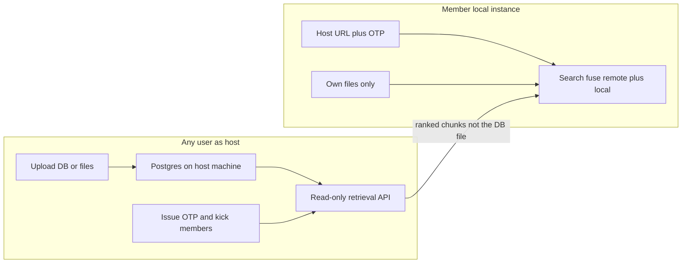

# Hybrid RAG local UI + universal v24

**Workspace:** `[C:\studies things\PRojects personal\chatbotattempts\chatbotv1\enterpriselevelcheck](C:\studies things\PRojects personal\chatbotattempts\chatbotv1\enterpriselevelcheck)` (local is ahead of GitHub; GitHub currently has engine files only, not `[app.py](C:\studies things\PRojects personal\chatbotattempts\chatbotv1\enterpriselevelcheck\app.py)`). After you approve, the agent should `move_agent_to_root` to this folder before edits.

**What already exists:** `[v24.py](C:\studies things\PRojects personal\chatbotattempts\chatbotv1\enterpriselevelcheck\v24.py)` already supports ZIP/file ingest (`process_uploads`), Claude/Gemini/OpenAI/OpenAI-compatible generation, `compare()` vs `compare_single()`, a smart router, and a half-finished Postgres path. `[app.py](C:\studies things\PRojects personal\chatbotattempts\chatbotv1\enterpriselevelcheck\app.py)` ignores almost all of that: one global SQLite DB at startup, OpenAI-only keys, stacked markdown, no upload/retain/delete, no slider.

## 1. PostgreSQL as the real multi-user store

Keep SQLite as a fallback for tiny local tests, but default the app to `DATABASE_URL` (Postgres + `pgvector` if present).

**Schema (roles + isolation):**

- There is **no single global admin**. On every local instance, anyone can click **Host this corpus** after they upload (or attach) a DB. Hosting is per-corpus, not a privileged install role. The same person can host corpus A and join someone else’s corpus B.
- `users` on the **host** machine: display name + session token for that instance only.
- `corpora` on the host: `kind` `hosted` (the shared DB/files this machine stores) or `personal` (only this machine’s owner overlay). Members never get a `hosted` row copied to their Postgres.
- `otp_codes` / `memberships` live **only on the host**. OTP hashed; 6-digit; TTL; max uses or until rotated. Kick deletes membership so that session token can no longer call retrieval.
- Chunks/FTS/entities for a hosted corpus exist **only on the host disk/Postgres**. Member machines store at most: host URL, membership token, corpus name, partition keyword summary (tiny). **No chunk text, no zip, no SQLite/Postgres copy of the admin DB.**

**Fix the current Postgres backend before relying on it:**

- [`DatabaseManager._query` / `_many`](C:\studies things\PRojects personal\chatbotattempts\chatbotv1\enterpriselevelcheck\v24.py) always run `PRAGMA journal_mode=WAL` — that will throw on Postgres. Guard with `if not self.use_postgres`.
- Use a **threaded connection pool** (`psycopg2.pool`) instead of connect/close per query.
- Fix `fts_search` for Postgres: today it builds an OR string then passes it to `plainto_tsquery`, which ignores `|`. Use `to_tsquery` / `websearch_to_tsquery` (or `plainto_tsquery` on the raw question) plus a GIN index (already attempted).
- Cap FTS terms on Postgres the same way SQLite uses `fts5vocab` (pg `ts_stat` or a small `term_frequency` table).
- Rebuild `entity_frequency` automatically after ingest (today it depends on a separate backfill script).

**16GB `hybrid_rag_v22.db`:** do **not** auto-import it into Postgres (too heavy for a UI change). Optional later: a one-shot `migrate_sqlite_to_pg.py`. The Library tab can still **attach** an existing SQLite file as a read-only corpus if you want the current eval DB without a 16GB copy.

## 2. Host/join: anyone hosts, OTP, no member-side copy of the admin DB

**Guarantee:** members **do not download or upload** the admin files/DB. They never ingest it. Admin context **does not occupy user disk** beyond a small join record. Retrieval returns only the **top ranked chunk texts** needed for the current question (ephemeral in RAM for that request), not a replica of the corpus.

**Anyone can be host**
- Upload ZIP/files **or** point at a DB already on that machine (`hybrid_rag_v22.db` / Postgres).
- Click **Host / share**. The app binds a **read-only retrieval HTTP API** on the host (separate from Gradio or a FastAPI sidecar; LAN bind `0.0.0.0` with the OTP as the secret).
- UI shows **join URL** (this PC’s LAN IP + port) and **Issue OTP**. Copy both to members.
- **Members** table: name, joined at, last seen. **Kick** invalidates that member token immediately. **Rotate OTP** issues a new code; old unused codes die; existing members stay until kicked.
- Only the host can add/replace/delete hosted files. Member API is retrieve-only (search, get chunk texts by id). No ingest, no delete, no schema writes.

**Member join (other local Hybrid RAG instances)**
- Fields: **Host URL** + **OTP** + display name. Redeem against the host API → session token stored locally (not the corpus).
- No file picker for admin data. If the host is offline, shared retrieval fails; local overlay still works.
- Member **cannot** edit host context. They can only change **their own** local corpora (temp or retain) and their own files.
- Search: remote Hybrid/Standard retrieval on the **host** (host CPU/Postgres/latency) fused with **local** overlay retrieval. Sources tagged `host` vs `mine`. Generation uses the **member’s** API key on the member machine (chunk texts in the prompt only).

**Same person both roles:** you can host your DB and, in another row, join a colleague’s host. Hosting does not block having local personal files.

**LLM keys:** each instance uses its own OpenAI/Anthropic/Gemini/Ollama key. Host is not billed for members’ completions.

**Engine lifecycle**
- Host: one cached lazy engine for the hosted corpus; members never build that index.
- Member: cache only personal overlay engines; remote path is HTTP `search` + `chunks`.
- Host re-ingest invalidates host cache only.

**Network caveat (in UI copy):** host PC must be reachable (same LAN or a tunnel). This is not a cloud file share and does not copy the 16GB DB to members.

## 3. Library UX (host vs local)

Tabs: **Host** | **Join** | **My library** | **Search**.

**Host tab (any user who uploaded/attached a corpus)**
- Issue OTP, join URL, member list, kick, rotate, stop hosting.
- Retain/delete applies only to **this machine’s** hosted corpus.

**Join tab**
- URL + OTP. Leave host (drops local token only). No local copy to delete because none was stored.

**My library**
- Upload ZIP/files for **this instance only**. Retain or one-shot. Delete cascade on local overlay only. Unrelated to host DB.

## 4. Search UX: testing vs production, slider, providers

**Mode (radio)**

- **Testing:** always run Standard and Hybrid independently (`force_hybrid=True` semantics, but do **not** copy Standard into the Hybrid slot). Run the two pipelines in **parallel** (`concurrent.futures`) so comparison latency is ~max, not sum. Render **two columns**: answers, latency, tokens, token savings %, retrieval confidence, chunk/answer relevance (existing proxies — not a gold-label accuracy score), chunk count, sources.
- **Production:** `compare_single(..., method="hybrid_rag")` only. Slider still applies.

**Hybrid intensity slider (0 = faster / less Hybrid, 1 = more Hybrid / more savings & recall)**

Map one 0–1 control onto existing knobs so users do not edit env vars:

| Slider | Effect                                                                                                                                                                      |
| ------ | --------------------------------------------------------------------------------------------------------------------------------------------------------------------------- |
| Low    | Raise skip-Hybrid bar: lower `ROUTER_STANDARD_CONFIDENCE_HIGH`, skip last-resort rerank, smaller `LEXICAL_CANDIDATE_LIMIT` / `LAST_RESORT_CANDIDATE_POOL`, fewer max chunks |
| High   | Unreachable HIGH (always Hybrid), lower `ROUTER_LAST_RESORT_THRESHOLD` (more cross-encoder/embedding escalation), larger candidate pool                                     |

Production never runs Standard; the slider only changes **how much Hybrid work** (graph + RRF always; last-resort rerank and pool size scale with the slider). Testing always shows both answers; the slider only changes the Hybrid column.

**Providers (dropdown + key/model fields, not stored on disk by default)**

- OpenAI (`OPENAI_API_KEY` / model)
- Anthropic
- Google Gemini (`google-genai`, already in v24)
- **Ollama as a first-class provider:** OpenAI-compatible client at `http://localhost:11434/v1`, model e.g. `llama3.1`, dummy key. Today this is only the unlabeled `"compatible"` slot in `available_provider_configs`.

Uncomment/add `anthropic`, `google-genai`, `psycopg2-binary`, `gradio`, `pymupdf` in `[requirements.txt](C:\studies things\PRojects personal\chatbotattempts\chatbotv1\enterpriselevelcheck\requirements.txt)`. Drop the `sk-` prefix check in `app.py`.

Wire `key_override` so a pasted key works for the **selected** provider (today override only applies when `preferred == name`).

## 5. v24 universality review (engine changes)

v24 already tries to be corpus-agnostic (folder partitions, KMeans/keyword fallback, YAML routing). Gaps that stop “any DB”:

**Routing is still enterprise-hardcoded.** `_DEFAULT_PARTITION_KEYWORDS` is Jira/Slack/GitHub/…. After ingest, **auto-write partition keywords** from: folder names, cluster top-TF-IDF terms, and frequent spaCy ORG/PRODUCT entities. Merge into `PARTITION_KEYWORDS` for that corpus so `_get_active_partitions` works without a hand-written YAML. Keep YAML as an override.

**Cluster labels are opaque** (`partition_cluster_0`). Rename clusters from top terms (`partition_auth_api`) so keyword routing and the UI make sense.

**Postgres FTS + term capping** as in section 1 — otherwise Hybrid on PG is weaker and slower than SQLite FTS5.

**Latency without giving up Hybrid quality**

- Parallel per-partition FTS + entity searches (today sequential in `_get_cross_domain_rankings_disk`).
- Last-resort rerank only when slider/confidence says so (already the lazy-mode design; keep it, don’t run TinyBERT on every Hybrid query).
- Cache spaCy `nlp` (already lazy); avoid double-defined `_get_spacy_nlp` / `_add_regex_ids` in the file.
- Neutral generation prompt (“retrieved evidence”, not “research papers”).

**Chunking:** keep 220-word overlap as default; add a light structure pass (split on markdown/PDF headings when present) so mixed dumps don’t become one mush. Do not require corpus-specific stopwords.

**Accuracy claim:** keep showing `confidence_score`, `relevance_score`, `answer_relevance`, token stats. Do not label lexical overlap as “accuracy” in the UI. Optional later: LLM-as-judge only in Testing.

**Out of scope for this pass:** shipping or syncing the 16GB SQLite file to members; SSO/email; host-paid LLM keys; NAT/cloud relay (LAN or user-provided tunnel only); extra file types beyond pdf/txt/md/py/js/ipynb/zip.

## 6. Implementation order

1. Host Postgres pool + PRAGMA/FTS + hosted vs personal corpora; **do not** replicate hosted tables to members.
2. Read-only retrieval API on the host; OTP issue/redeem/kick; session tokens.
3. Member client: join by URL+OTP; fuse remote ranked chunks with local overlay; never write host chunks to disk.
4. Auto partition-keyword generation after host ingest.
5. Named `ollama` provider + slider `set_hybrid_intensity`.
6. Gradio: Host / Join / My library / Testing vs Production search.
7. `docker-compose` Postgres for the **host** machine; `env.example` with `DATABASE_URL` and `HOST_BIND` (no `ADMIN_SETUP_CODE` gate).
8. Smoke on two processes: host upload + OTP; member joins with **no** files and **no** extra DB growth; member overlay only changes local; kick drops remote retrieval; host files unchanged from member actions.

## Source of truth vs GitHub

Implement in the local `enterpriselevelcheck` tree (`v24.py` + `app.py`). Push to [pjbrav/Enterprise-level-Hybrid-RAG-chatbot-system](https://github.com/pjbrav/Enterprise-level-Hybrid-RAG-chatbot-system) only if you ask for a commit/PR afterward.